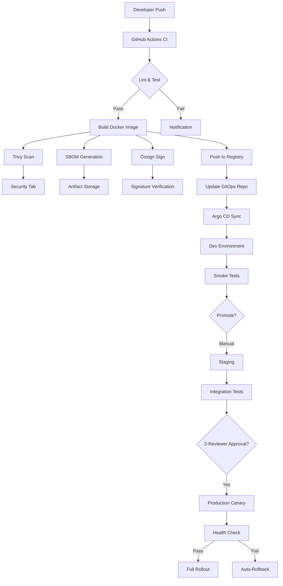
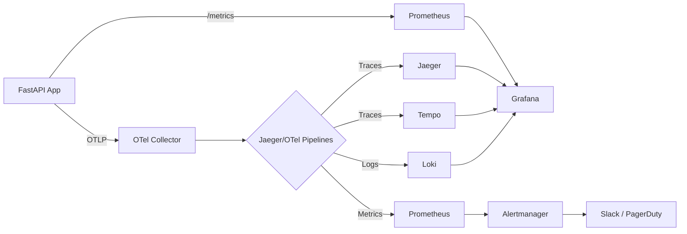
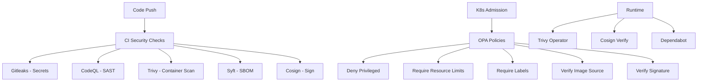

# Architecture

## CI/CD Pipeline Flow

## Observability Pipeline

## Security Layers

## Component Relationships

### Application Layer
- **FastAPI** serves HTTP endpoints with Prometheus metrics on `/metrics` and OTel traces sent via OTLP
- **structlog** provides structured JSON logging to stdout
- **Health probes** (`/healthz`, `/readyz`) enable Kubernetes liveness/readiness checks

### CI/CD Layer
- **GitHub Actions** orchestrates the entire pipeline with concurrency control
- **Docker Buildx** builds multi-arch images (amd64 + arm64) with layer caching
- **Argo CD** syncs the Helm chart to the target cluster via GitOps

### Kubernetes Layer
- **Helm** manages application configuration via values files per environment
- **HPA** auto-scales based on CPU (70%) and memory (80%)
- **PDB** ensures minimum availability during disruptions
- **TopologySpreadConstraints** distributes pods across zones and nodes

### Observability Layer
- **OTel Collector** receives OTLP data, processes, and fans out to backends
- **Prometheus** scrapes metrics from the app, kube-state-metrics, and node-exporter
- **Grafana** provides dashboards with Prometheus, Loki, and Tempo datasources
- **Alertmanager** routes alerts by severity with Slack integration

### Security Layer
- **OPA** enforces admission policies on all Kubernetes resources
- **Trivy** scans containers at build time and continuously in the cluster
- **Cosign** signs container images for supply chain integrity
- **Vault** manages secrets with dynamic database credentials
